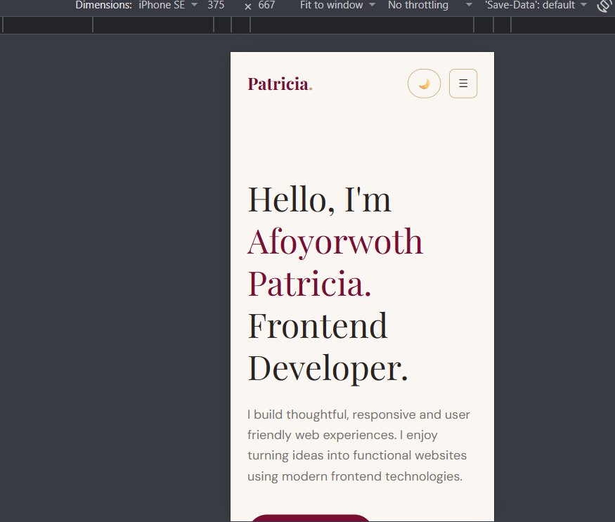
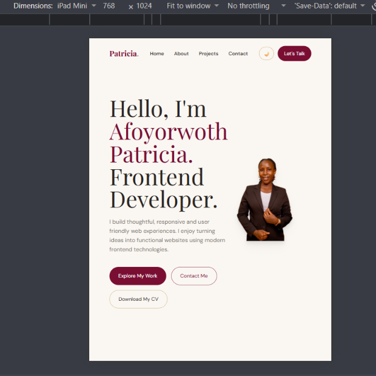
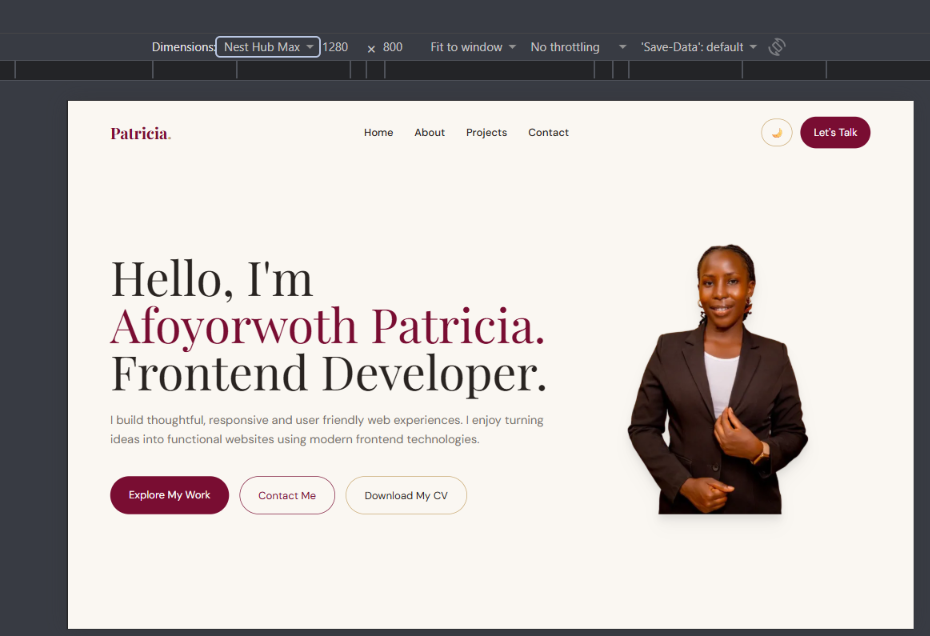
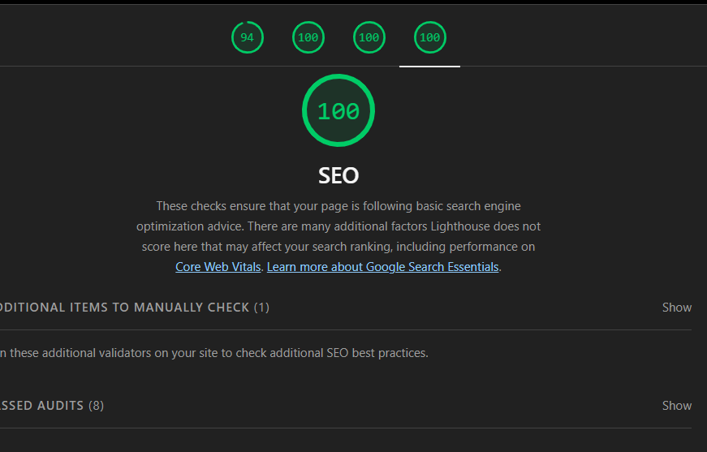

# Afoyorwoth Patricia | Frontend Developer Portfolio

## Project Overview

**Project Name:** Afoyorwoth Patricia Portfolio  
**Selected Option:** Option A – Personal Portfolio

This is a responsive personal portfolio website developed to showcase my frontend development skills, projects and professional background. It provides visitors with information about me, the technologies I use, projects I have worked on and ways to contact me. The website was built using React, Tailwind CSS and React Router, with a focus on usability, accessibility and responsive design. It also includes a downloadable CV and a working contact form.

## Live Website

https://afoyorwoth-patricia-portfolio.vercel.app/

## GitHub Repository

https://github.com/afoyorwoth/my-portfolio-Final

## Technologies Used

- React
- JavaScript
- Tailwind CSS
- React Router
- Vite
- HTML5
- CSS3
- Git and GitHub
- Vercel
- Formspree

## Main Features

- Responsive homepage with personal introduction and profile image.
- About page highlighting my background, skills and development approach.
- Projects page displaying completed and planned projects.
- Dynamic project detail pages using React Router.
- Custom 404 page for unavailable routes.
- Contact form with input validation and submission feedback.
- Contact form integration using Formspree.
- Dark and light mode.
- Responsive navigation with a mobile menu.
- Downloadable CV.
- Keyboard-accessible navigation and interactive elements.

## Project Structure

```text
my-portfolio/
├── public/
│   ├── screenshots/
│   └── Afoyorwoth-Patricia-CV.pdf
├── src/
│   ├── assets/
│   ├── components/
│   ├── pages/
│   ├── App.jsx
│   ├── index.css
│   └── main.jsx
├── index.html
├── package.json
├── tailwind.config.js
└── README.md
```

## Getting Started

To run the project locally:

1. Clone the repository:

```bash
git clone https://github.com/afoyorwoth/my-portfolio-Final.git
```

2. Navigate into the project folder:

```bash
cd my-portfolio-Final
```

3. Install dependencies:

```bash
npm install
```

4. Start the development server:

```bash
npm run dev
```

5. Build the project for production:

```bash
npm run build
```

## Responsive Design Evidence

The website was tested at the following viewport sizes:

### Mobile – 375 × 667



### Tablet – 768 × 1024



### Desktop – 1280 × 800



## Lighthouse Performance and Quality Testing

The website was tested using Google Lighthouse in Chrome DevTools.

### First Recorded Audit

| Category | Score |
|---|---:|
| Performance | 96 |
| Accessibility | 95 |
| Best Practices | 100 |
| SEO | 91 |


### Latest Audit

| Category | Score |
|---|---:|
| Performance | 94 |
| Accessibility | 100 |
| Best Practices | 100 |
| SEO | 100 |



**Audit note:** The first recorded audit was captured before the final contrast, metadata and image optimization improvements. An earlier pre-development audit was not captured.

### Improvements Made

- Improved text contrast on the homepage.
- Added a descriptive meta description and an appropriate page title.
- Converted the profile image from PNG to WebP, reducing its size from approximately 259.6 KB to 20.9 KB.
- Checked responsive layouts at mobile, tablet and desktop widths.
- Reviewed keyboard navigation and accessibility.

### Remaining Performance Opportunities

The latest Lighthouse report identified opportunities to reduce unused JavaScript, improve JavaScript minification and investigate back/forward cache restoration.

## Known Limitations

- The contact form depends on the external Formspree service to receive messages.
- The portfolio currently contains one completed featured project, VowMemories. Nurtiva and HomeTogether are planned concepts, not completed applications.
- The portfolio does not currently include a backend or database for managing project content.
- Lighthouse performance results may vary depending on the testing environment and network conditions.

## Future Improvements

- Add more completed projects as I continue learning and building.
- Explore backend development and database integration.
- Further optimize JavaScript delivery and performance.
- Continue improving accessibility and search engine visibility.
- Expand the portfolio with additional project demonstrations.

## Author

**Afoyorwoth Patricia**  
Frontend Developer

- GitHub: https://github.com/afoyorwoth
- LinkedIn: https://www.linkedin.com/in/patricia-afoyorwoth

